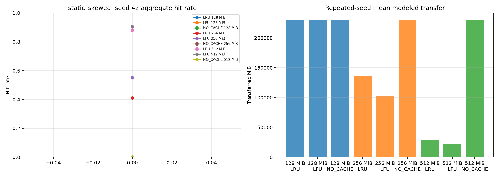
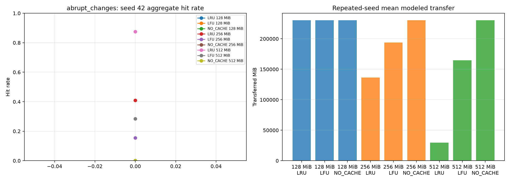
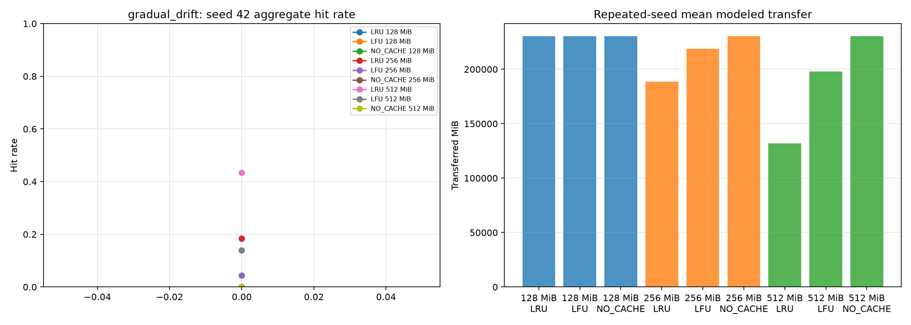
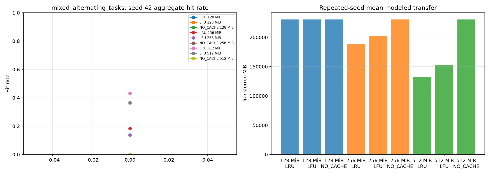
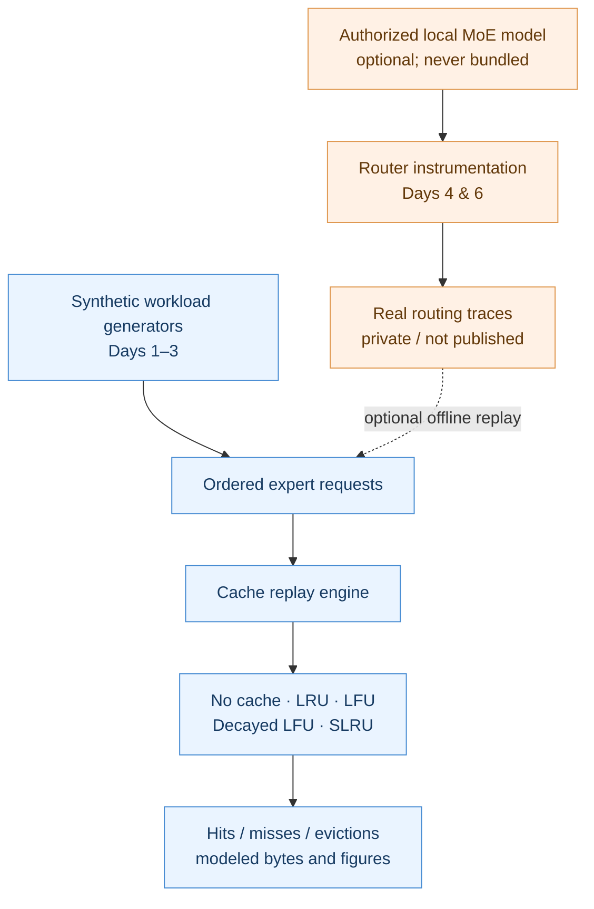

<div align="center">

# 🧠 MoE Memory Lab

### Exploring expert routing, cache replacement, and memory-efficient LLM inference

**A reproducible AI systems research prototype — from synthetic workloads to real-router instrumentation.**

[](https://www.python.org/)
[](https://github.com/Adityajaiswal9050/moe-memory-lab/actions/workflows/synthetic-tests.yml)
[](LICENSE)


[**Explore results**](#-selected-results) · [**Architecture**](#-how-it-works) · [**Run locally**](#-quick-start) · [**Methodology**](docs/METHODOLOGY.md) · [**Benchmark details**](docs/BENCHMARKS.md)

</div>

---

> [!IMPORTANT]
> **Scope and evidence.** This is a cache-replay and routing-analysis research project, **not** a production inference engine. Published benchmark figures come from **synthetic workloads**. The code supports authorized real-model routing collection, but gated model assets, real traces, and their derived results are intentionally excluded pending the applicable license review. **No inference speedup, disk I/O improvement, or measured offloading acceleration is claimed.**

## 🎯 The research question

Mixture-of-Experts (MoE) models select only a subset of expert networks for each token. That helps reduce active compute, but when experts cannot all live in fast memory, **which experts should a hypothetical cache retain?**

MoE Memory Lab investigates how recency, frequency, and changing routing patterns affect expert-cache hit rates under a constrained memory budget.

<table>
<tr>
<td align="center"><strong>5</strong><br/><sub>cache policies implemented</sub></td>
<td align="center"><strong>4</strong><br/><sub>synthetic workload families</sub></td>
<td align="center"><strong>5</strong><br/><sub>repeated seeds in Day 3</sub></td>
<td align="center"><strong>35</strong><br/><sub>local unit tests last verified</sub></td>
</tr>
</table>

**Policies:** No cache · LRU · LFU · exponentially decayed LFU · segmented LRU (SLRU).

## 📊 Selected results

### Workload shifts change which policy wins

**Mean synthetic cache hit rate (%)** at a **512 MiB simulated cache budget**, over seeds **42–46** (Day 3).

| Synthetic workload | LRU | LFU | Better of these two |
|:--|--:|--:|:--|
| Static skew + cold tail | 87.84% | **90.26%** | LFU |
| Abrupt hot-set changes | **87.20%** | 28.44% | LRU |
| Gradual drift | **42.83%** | 14.11% | LRU |
| Alternating task patterns | **42.60%** | 33.83% | LRU |

**Interpretation:** frequency can help when the working set is stable; stale frequency information can hurt when routing changes. These workloads were constructed by us, so this table **does not establish behavior on real models**.

<p align="center">
  
  
</p>
<p align="center"><sub>Day 3 synthetic workload comparisons. “Transfer” is modeled as misses × assumed expert size, not measured I/O.</sub></p>

<details>
<summary><strong>More published workload figures</strong></summary>

<p align="center">
  
  
</p>

- [Day 1–2 phase analysis](figures/phase_hit_rate_and_transfer.png)
- [Full benchmark tables, sources, and caveats](docs/BENCHMARKS.md)
</details>

### An instructive baseline failure

The original baseline generator had **no cold-tail requests**. At 512 MiB it gave LRU a **99.17% hit rate**, which initially looked impressive. Day 3's audit showed that the synthetic workload was too easy to cache; after adding a cold tail and changing working sets, the result became much more sensitive to the workload.

**A seemingly strong benchmark can be a property of its generator, not of a better algorithm.** [See the full analysis](docs/BENCHMARKS.md#why-the-first-baseline-was-misleading).

## 🧩 How it works



**Important distinction:** a router trace records *which expert was selected*; a cache replay estimates *how a policy would behave* if those requests were serviced by a bounded cache. This repo does **not** move weights between GPU, CPU RAM, and SSD during inference.

For an implementation walkthrough, event-order assumptions, and formulas, see [Architecture & methodology](docs/METHODOLOGY.md).

## ⚡ Quick start

The **public synthetic experiments need no GPU, Hugging Face login, model download, or PyTorch**.

**Windows PowerShell · Python 3.12**

```powershell
git clone https://github.com/Adityajaiswal9050/moe-memory-lab.git
cd moe-memory-lab
py -3.12 -m venv .venv
.\.venv\Scripts\python.exe -m pip install -r requirements-synthetic.txt

# Generate deterministic synthetic results and figures
.\.venv\Scripts\python.exe baseline.py
.\.venv\Scripts\python.exe analysis.py
.\.venv\Scripts\python.exe day3_analysis.py
```

**Run the synthetic test subset (15 tests):**

```powershell
.\.venv\Scripts\python.exe -m unittest discover -s tests -p "test_baseline.py" -v
.\.venv\Scripts\python.exe -m unittest discover -s tests -p "test_analysis.py" -v
.\.venv\Scripts\python.exe -m unittest discover -s tests -p "test_day3.py" -v
```

Run these generation commands in a fresh checkout or copy: they write to `data/`, `results/`, and `figures/`. The public CI workflow runs the synthetic test subset only.

[**Full setup, optional dependencies, and real-model boundaries →**](docs/METHODOLOGY.md#reproducing-the-experiments)

## 🔬 Research journey

| Stage | Research track | Where to look |
|:--|:--|:--|
| **Day 1** | Synthetic cache baseline: no cache, LRU, LFU | [`baseline.py`](baseline.py) |
| **Day 2** | Phase changes, seed variance, alternate ordering | [`analysis.py`](analysis.py) |
| **Day 3** | Baseline audit and four harder synthetic workloads | [`day3_analysis.py`](day3_analysis.py) · [figures](figures/day3/) |
| **Day 4** | Guarded, optional real-model router instrumentation | [`real_trace/smoke_test.py`](real_trace/smoke_test.py) |
| **Day 5** | Real-trace schema, expert reuse and cache replay | [`day5_analysis.py`](day5_analysis.py) |
| **Day 6** | Multi-prompt capture and reset-versus-persistent cache replay | [`day6_analysis.py`](day6_analysis.py) |
| **Day 7** | Decayed LFU, SLRU and offline policy comparisons | [`day7_policies.py`](day7_policies.py) |

Days 4–7 are published as **original code and methodology**, not a public model benchmark. Their runtime inputs and model-derived reports remain local.

### Repository map

```text
moe-memory-lab/
├── baseline.py, analysis.py          # Days 1–2
├── day3_workloads.py, day3_analysis.py
├── day5_analysis.py                  # Offline routing reuse & cache replay
├── day6_analysis.py                  # Multi-prompt replay analysis
├── day7_policies.py, day7_analysis.py
├── real_trace/
│   ├── collector.py                  # Router-event instrumentation
│   ├── smoke_test.py                 # Guarded single-prompt capture
│   └── day6_pilot.py                 # Guarded multi-prompt capture
├── tests/                            # 15 synthetic + 20 standalone tests
├── data/                             # Synthetic traces
├── results/                          # Published synthetic CSVs
├── figures/                          # Published synthetic plots
└── docs/                             # Benchmark and methodology notes
```

## 🧪 What is measured — and what is not

| Metric | Status |
|:--|:--|
| Synthetic request counts and cache hits/misses | **Computed by simulator** |
| Synthetic modeled weight-transfer bytes | **Misses × assumed expert size** |
| Assumed I/O latency in early simulation | **Illustrative constant, not hardware timing** |
| Authorized local router selections | Instrumentation supported; **derived data not published** |
| GPU↔RAM↔SSD transfers and tokens/second | **Not measured by this project** |

A prefill routing trace is serialized for replay, although actual inference processes a batch of prompt tokens and may coalesce expert loads. A good cache miss rate is **not** automatically a faster model.

## 🔐 Responsible use & licensing

- **Included:** original code, synthetic traces, public synthetic results and figures, and public fixture-based tests.
- **Excluded:** Hugging Face credentials, gated MobileMoE source/tokenizer/configuration/weights, the local integrity manifest, actual routing traces, and Day 4–7 model-derived outputs.
- The optional capture scripts require **independently authorized model access**, acceptance of the model's terms, and a trusted locally supplied `real_trace/model_integrity.json`. They stop if required integrity checks fail.
- The [MIT license](LICENSE) applies to **original MoE Memory Lab contributions only**; it does not relicense third-party assets or model outputs. Real-model derived results are on publication hold pending review of the model's FAIR Noncommercial Research License.

See [the release boundary](PUBLIC_RELEASE_PLAN.md) and [the optional workflow](docs/METHODOLOGY.md#optional-authorized-real-model-workflow).

## 🧭 Next research steps

- [ ] Evaluate policies on a preregistered, held-out prompt set **if permitted**
- [ ] Compare against stronger established adaptive policies and quantify metadata/compute overhead
- [ ] Model expert sizes, concurrent prefill access, and transfer overlap more faithfully
- [ ] Integrate actual expert offloading in a separate runtime
- [ ] Measure end-to-end transfer costs, latency, and throughput before making performance claims

---

<div align="center">
  <sub>Built as an independent learning and systems-research project. Contributions and constructive feedback are welcome through <a href="https://github.com/Adityajaiswal9050/moe-memory-lab/issues">GitHub Issues</a>.</sub>
</div>
