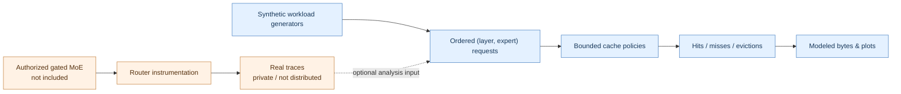

# Architecture & methodology

[← Back to MoE Memory Lab](../README.md) · [Synthetic benchmark tables](BENCHMARKS.md)

## Research pipeline



## Synthetic routing and request identity

The Day 1 simulator uses **six layers**, each with **32 possible experts**. Every synthetic token step activates **two distinct experts per layer**, yielding `6 × 2 = 12` requests per token and **14,400 requests over 1,200 token steps**.

The cache key is the **(layer, expert ID)** pair, not expert ID alone: expert 7 in layer 0 is a different object from expert 7 in layer 1.

**Synthetic expert storage:** 16 MiB per cache entry, uniformly across requests in the baseline. The simulator has one global capacity budget shared by all layers.

## Cache-policy families

| Policy | Admission and replacement idea | Used in |
|:--|:--|:--|
| NO_CACHE | Every access is a miss; no resident experts | Baseline and replay |
| LRU | Evict the least recently used resident expert | Baseline and replay |
| LFU | Evict a least-frequently used resident expert | Baseline and replay |
| Decayed LFU | Age older access counts exponentially; break ties by recency | `day7_policies.py` |
| SLRU | Probationary segment for new keys; protected segment for repeatedly accessed keys | `day7_policies.py` |

The latter two are **existing cache-policy concepts**, implemented here for comparison. The decay score is updated lazily from elapsed request counts, and the SLRU implementation uses a defined probationary/protected capacity split; see source code for exact edge-case handling.

## Cache replay metrics

- **Hit:** the requested expert key is already resident.
- **Miss:** the key is not resident and must be admitted or treated as uncached.
- **Eviction:** a resident entry is removed to respect the capacity.
- **Modeled transfer:** misses multiplied by the assumed expert byte size.
- **Hit rate:** hits divided by total expert requests.

A higher hit rate can lower *modeled* weight demand, but doesn't establish lower real latency without an offloading runtime and actual transfer measurements.

The initial synthetic model includes an **assumed 100 ms per miss** as an illustration, not as hardware calibration.

## Reproducing the experiments

### Minimal public path — Windows / Python 3.12

```powershell
git clone https://github.com/Adityajaiswal9050/moe-memory-lab.git
cd moe-memory-lab

py -3.12 -m venv .venv
.\.venv\Scripts\python.exe -m pip install -r requirements-synthetic.txt

# Recompute published synthetic outputs
.\.venv\Scripts\python.exe baseline.py
.\.venv\Scripts\python.exe analysis.py
.\.venv\Scripts\python.exe day3_analysis.py
```

You can run the synthetic tests separately:

```powershell
.\.venv\Scripts\python.exe -m unittest discover -s tests -p "test_baseline.py" -v
.\.venv\Scripts\python.exe -m unittest discover -s tests -p "test_analysis.py" -v
.\.venv\Scripts\python.exe -m unittest discover -s tests -p "test_day3.py" -v
```

The published synthetic dependency is pinned in [`requirements-synthetic.txt`](../requirements-synthetic.txt). These tests and simulations need **no model files, HF authentication, PyTorch, or CUDA**.

> [!TIP]
> The generator scripts write into `data/`, `results/` and `figures/`. To compare outputs against the published versions without modifying them, run in a new clone or scratch copy.

### Optional Day 4–7 fixture tests

The research code contains standalone unit tests using constructed traces, fake model components, and temporary files. They are not real-model benchmarks. Some need the optional packages in [`real_trace/requirements.txt`](../real_trace/requirements.txt), including PyTorch.

```powershell
# After installing optional dependencies:
.\.venv\Scripts\python.exe -m unittest discover -s tests -p "test*.py" -v
```

At the last local verification, 35 standard unit tests passed: 15 synthetic-only plus 20 optional-workflow tests. The public CI job deliberately runs the 15 synthetic tests without GPU/model access.

## Optional authorized real-model workflow

The public repository includes original capture and replay **code**, but excludes the gated model and derived research outputs.

1. Obtain access to the relevant model from its owner and accept all applicable terms.
2. Audit any model custom code before allowing it to execute.
3. Obtain the matching, **trusted** `real_trace/model_integrity.json` privately. The public repo deliberately does not include this manifest; do **not** generate expected hashes from untrusted downloaded code.
4. Independently obtain the matching model source, configuration, tokenizer assets, and weights from the authorized provider and keep them under the ignored local `real_trace/model_source/`.
5. Use the exact pinned versions in the runtime requirements. For the recorded Windows/CUDA path:

   ```powershell
   .\.venv\Scripts\python.exe -m pip install torch==2.8.0+cu128 --index-url https://download.pytorch.org/whl/cu128
   .\.venv\Scripts\python.exe -m pip install -r real_trace/requirements.txt
   ```

6. Review hardware memory headroom and run only approved capture experiments. The loaders check audited source digests and model weight size/SHA-256 before executing custom model code; no automatic fallback is attempted after CUDA OOM.

The runtime integrity checks do **not** individually hash tokenizer and configuration files. Keep the trust boundary explicit.

### Prefill versus decode

Real-model routing traces are captured separately for **prefill** (processing the whole prompt) and **decode** (autoregressive token steps). In offline analysis, events are replayed serially in a documented order.

**Limit:** prefill runs batched execution in the model, so serialized cache replay can exaggerate, miss, or reorder physical weight-load opportunities; GPU kernels may coalesce accesses and overlap transfers. Decode replay is closer to serial token generation but still does not measure real I/O.

### Cross-prompt cache state

Multi-prompt replay distinguishes:

- **Reset per prompt:** empty the cache before each request.
- **Persistent cache:** carry the current cache state into the next request in fixed order.

Comparisons must not mix these scenarios or tune policy parameters using held-out test data.

## Limitations and research roadmap

- Synthetic routing is not a learned router; some workloads were deliberately constructed to expose cache-policy weaknesses.
- Experimental prompts and real routing outputs are excluded from the public release pending model-terms review.
- Decayed LFU and SLRU may be sensitive to hyperparameters and cache budget.
- A useful next phase would preregister a held-out prompt set, preserve trace provenance, benchmark more replacement strategies, and ultimately integrate genuine offloading with wall-clock measurements.

[See reproducible synthetic results →](BENCHMARKS.md)
